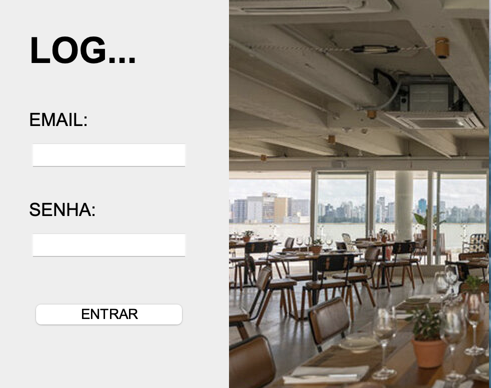
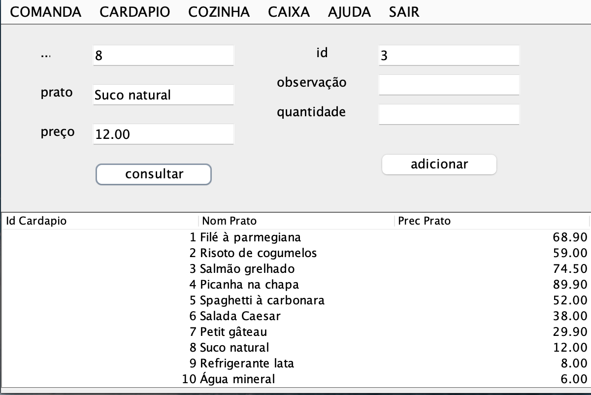
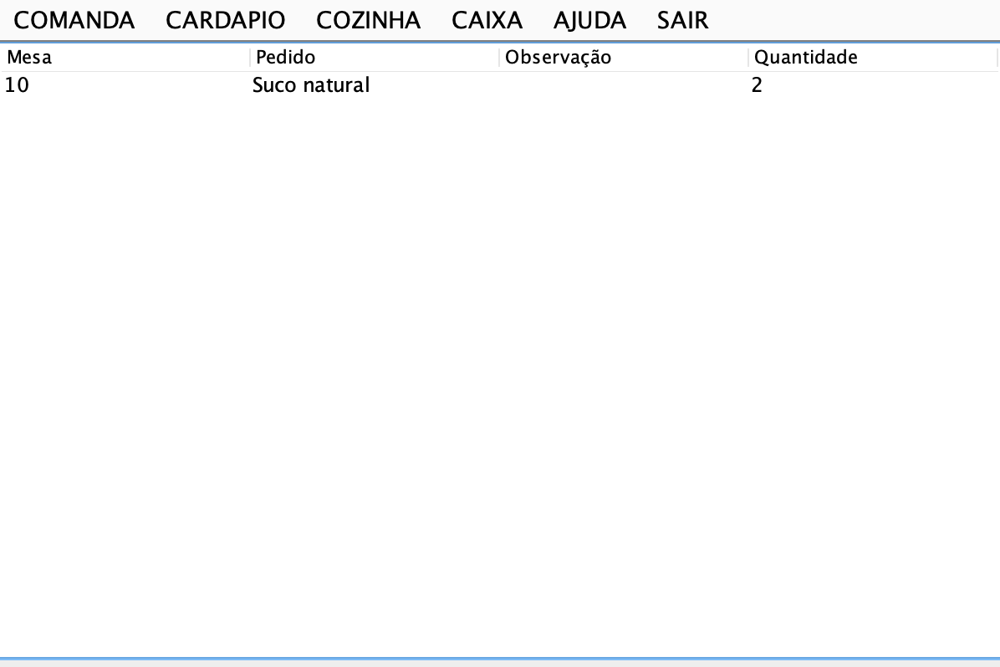
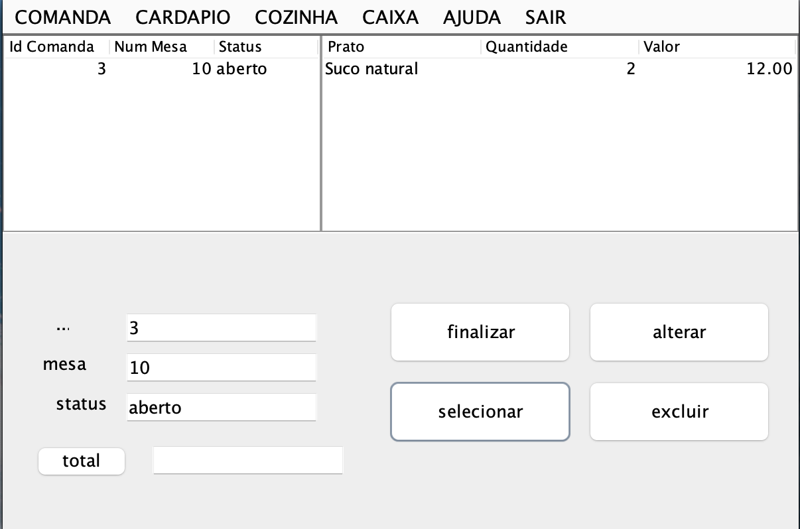

# 🍽️ Restaurante Vista

Sistema desktop de gestão de restaurante feito em **Java (Swing)** com banco de dados **MySQL**.

Ele cobre o atendimento de ponta a ponta: o garçom abre a comanda da mesa, lança os pedidos a partir do cardápio, a cozinha acompanha os pedidos em tempo real e o caixa calcula o total e fecha a conta.

> Projeto desenvolvido como **case acadêmico**, com o objetivo de praticar orientação a objetos, interfaces gráficas em Java e integração com banco de dados relacional.

---

## 📸 Telas (*tem mais telas)

| Login | Cardápio  |
|---|---|
|  |  |

| Cozinha | Caixa |
|---|---|
|  |  |

---

## ✨ Funcionalidades

| Tela | O que faz |
|---|---|
| **Splash** | Tela de carregamento que inicia o sistema e prepara a conexão com o banco. |
| **Login** | Acesso do garçom ao sistema. |
| **Menu** | Tela principal, com a barra de navegação para todas as áreas. |
| **Comanda** | Abre uma comanda para uma mesa, com número da mesa e status (ex.: "aberta"). |
| **Cardápio** | Lista os pratos cadastrados. Busca um prato pelo código (nome e preço vêm do banco) e lança o pedido em uma comanda, com quantidade e observação (ex.: "sem cebola"). |
| **Cozinha** | Mostra os pedidos que chegaram (mesa, prato, observação e quantidade), **atualizando sozinha a cada 5 segundos**. |
| **Caixa** | Consulta uma comanda, mostra os itens, **calcula o total da conta** e permite alterar, finalizar ou excluir a comanda. |

---

## 🛠️ Tecnologias

- **Java 17+** com **Swing** (interface gráfica)
- **MySQL 8+** (banco de dados)
- **JDBC** com o driver `mysql-connector-j` (consultas e gravações)
- **JPA / EclipseLink 2.7** + **Beans Binding** (preenchimento automático de algumas tabelas da interface)
- **Apache NetBeans** (IDE e editor visual das telas)

---

## 📁 Estrutura do projeto

```
Restaurante_Vista/
├── lib/                         # Bibliotecas (.jar) já incluídas
│   ├── beansbinding-1.2.1.jar
│   ├── eclipselink-2.7.15.jar
│   ├── javax.persistence-api-2.2.jar
│   └── mysql-connector-j-9.1.0.jar
├── nbproject/                   # Configurações do projeto NetBeans
├── src/
│   ├── Controller/              # Regras e acesso ao banco
│   │   ├── Conecta_DAO.java     # Carrega o driver do MySQL
│   │   ├── Funcoes_DAO.java     # Cadastrar, consultar, alterar e excluir (+ dados de conexão)
│   │   └── Login_DAO.java       # Validação do login
│   ├── View/                    # Telas (Swing) e entidades JPA
│   │   ├── Splash_GUI.java
│   │   ├── Login_GUI.java
│   │   ├── Menu_GUI.java
│   │   ├── Comanda_GUI.java
│   │   ├── Cardapio_GUI.java
│   │   ├── Cozinha_GUI.java
│   │   ├── Caixa_GUI.java
│   │   └── Cardapio.java, Comanda.java, Pedido.java   # Entidades (tabelas)
│   ├── META-INF/persistence.xml # Configuração do JPA (conexão)
│   ├── Image/                   # Imagens das telas
│   └── main/Main.java           # Ponto de entrada (abre a Splash)
├── vista_restaurante.sql        # Script que cria o banco e insere pratos de exemplo
└── build.xml
```

O código segue uma divisão inspirada em **MVC**: a pasta `View` tem as telas e a pasta `Controller` tem a lógica e o acesso ao banco.

---

## 🗄️ Banco de dados

Banco: **`vista_restaurante`**, com 3 tabelas:

```
cardapio                comanda                 pedido
─────────────           ─────────────           ─────────────
id_cardapio (PK)        id_comanda (PK)         id_pedido (PK)
nom_prato               status                  prato
prec_prato              num_mesa                quantidade
                                                observacao
                                                valor
                                                id_comanda   → comanda
                                                id_cardapio  → cardapio
```

- **cardapio:** os pratos e seus preços.
- **comanda:** uma comanda por mesa atendida.
- **pedido:** cada item lançado, ligado a uma comanda e a um prato do cardápio.

O script `vista_restaurante.sql` cria tudo isso e já cadastra **10 pratos de exemplo**.

---

## ✅ Pré-requisitos

Instale, nesta ordem:

1. **JDK 17 ou superior.** Recomendado: [Temurin 21](https://adoptium.net/). No Mac, escolha a versão do seu processador: **Apple Silicon** (M1/M2/M3/M4) ou **Intel**.
2. **[Apache NetBeans](https://netbeans.apache.org/)**, versão mais recente.
3. **[MySQL Community Server](https://dev.mysql.com/downloads/mysql/) 8 ou superior.** Durante a instalação, **crie e anote a senha do usuário `root`**.
4. **[MySQL Workbench](https://dev.mysql.com/downloads/workbench/)** (opcional, mas facilita rodar o script).

> 💡 **Mac Intel:** as versões mais novas do MySQL só têm instalador para Apple Silicon. Use a aba **Archives** do site e procure uma versão com **macOS (x86, 64-bit), DMG Archive**.

As bibliotecas Java (`.jar`) **já estão na pasta `lib/`**, não precisa baixar nada.

---

## 🚀 Como rodar

### 1. Baixe o projeto

```bash
git clone https://github.com/EnzoGabrielPereira/restaurante-vista.git
```

Ou clique em **Code → Download ZIP** aqui no GitHub e descompacte.

### 2. Crie o banco de dados

Com o MySQL ligado:

**Pelo MySQL Workbench:**
1. Conecte em **Local instance 3306** com a senha do `root`.
2. **File → Open SQL Script…** → escolha `vista_restaurante.sql`.
3. Clique no **raio ⚡** para executar o script inteiro.
4. Em **Schemas**, clique em atualizar: o banco `vista_restaurante` deve aparecer com as 3 tabelas.

**Ou pelo terminal:**
```bash
mysql -u root -p < vista_restaurante.sql
```

### 3. Configure a senha do banco

O projeto vem com `SUA_SENHA_AQUI` no lugar da senha. Troque pela senha do seu `root` em **dois arquivos**:

- `src/Controller/Funcoes_DAO.java`
  ```java
  public static String password = "SUA_SENHA_AQUI";
  ```
- `src/META-INF/persistence.xml`
  ```xml
  <property name="javax.persistence.jdbc.password" value="SUA_SENHA_AQUI"/>
  ```

Se o seu MySQL não estiver em `localhost:3306` ou o usuário não for `root`, ajuste também `url` e `username` nesses mesmos arquivos.

### 4. Abra no NetBeans

1. **File → Open Project…** e selecione a pasta `Restaurante_Vista`.
2. Botão direito no projeto → **Properties → Libraries**:
   - Os 4 `.jar` da pasta `lib/` devem estar em **Classpath**, e **não** em Modulepath.
   - Se algum estiver faltando ou com aviso vermelho, remova e adicione de novo com **+ → Add JAR/Folder**.
   - Em **Java Platform**, selecione um JDK 17 ou superior.
3. Clique em **OK**.

### 5. Execute

Botão direito no projeto → **Clean and Build** → **Run**.
Se o NetBeans perguntar a classe principal, escolha **`main.Main`**.

---

## 🔑 Acesso

| Usuário | Senha |
|---|---|
| `garcom1` | `123` |

---

## 📖 Como usar (fluxo de um atendimento)

1. **Abra uma comanda:** menu **COMANDA** → informe o **número da mesa** e o **status** (ex.: `aberta`) → **cadastrar**.
   A primeira comanda criada recebe o id **1**, a segunda **2**, e assim por diante.
2. **Lance os pedidos:** menu **CARDAPIO**:
   - No campo de cima, à **esquerda**, digite o **código do prato** (veja na tabela) e clique em **consultar**. O nome e o preço são preenchidos sozinhos.
   - À **direita**, informe o **id da comanda**, uma **observação** (opcional) e a **quantidade**.
   - Clique em **adicionar**.
3. **Acompanhe na cozinha:** menu **COZINHA**. Os pedidos aparecem com mesa, prato, observação e quantidade, e a lista se atualiza a cada 5 segundos.
4. **Feche a conta:** menu **CAIXA** → digite o id da comanda → **selecionar** para ver os itens → o sistema calcula o **total**. Depois é possível **alterar**, **finalizar** ou **excluir** a comanda.

---

## 🧯 Problemas comuns

| Problema | Solução |
|---|---|
| **"Reference problems"** ao abrir no NetBeans | Vá em **Properties → Libraries**, remova as referências com erro e adicione os 4 `.jar` da pasta `lib/` em **Classpath**. |
| **"Form Loaded With Errors"** ao abrir uma tela no modo Design | As bibliotecas não estão no **Classpath** (ou estão em Modulepath). Corrija em Libraries e reinicie o NetBeans. **Não clique em "Allow Editing"**, porque isso pode apagar componentes da tela. |
| **"Access denied for user 'root'"** | A senha nos dois arquivos de configuração está diferente da senha do MySQL. |
| **"Communications link failure"** | O MySQL não está ligado. No Mac: **Ajustes do Sistema → MySQL → Start MySQL Server**. |
| **"Unknown database 'vista_restaurante'"** | O script `vista_restaurante.sql` não foi executado. Veja o passo 2. |
| **`NumberFormatException`** no Output | Algum campo numérico ficou vazio ou com texto (id, quantidade, mesa). Preencha todos os campos obrigatórios. |
| O Cardápio não mostra pratos | Confira se o script inseriu os pratos: no Workbench, botão direito em `cardapio` → **Select Rows**. |

---

## 👤 Autor

**Enzo Gabriel Pereira**
[GitHub](https://github.com/EnzoGabrielPereira)
